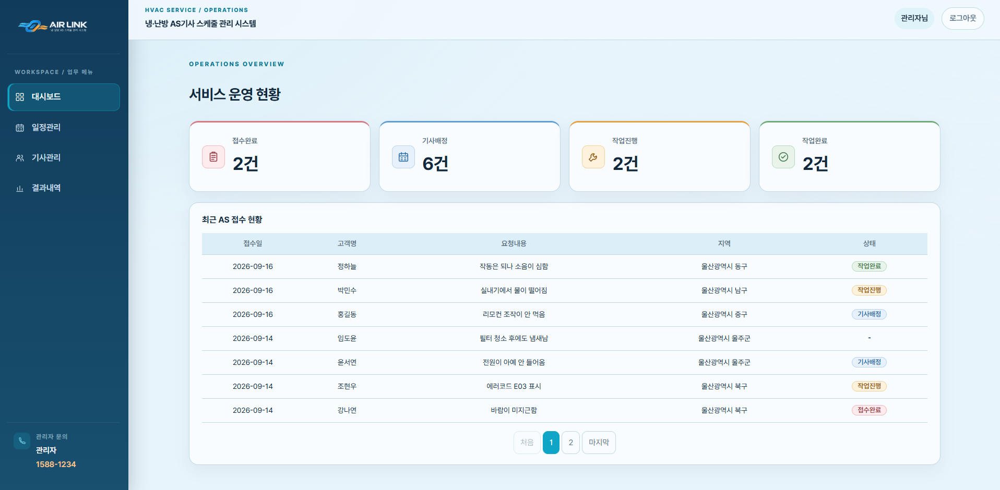
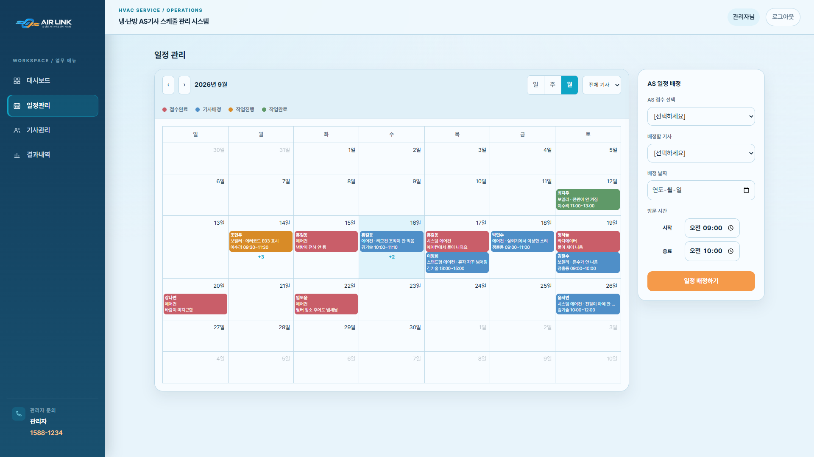
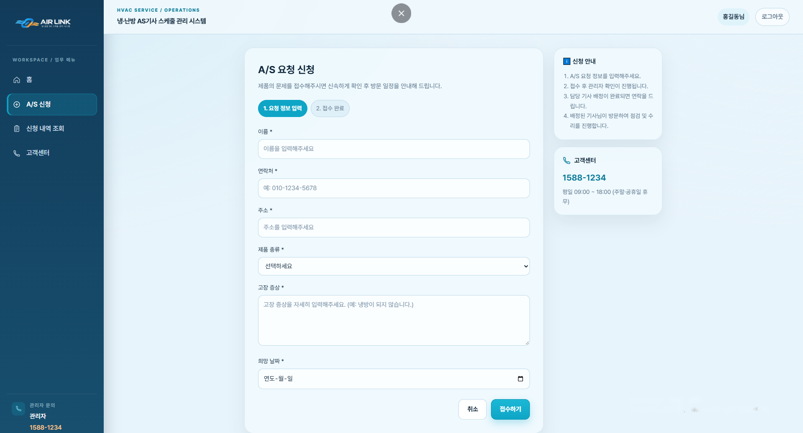
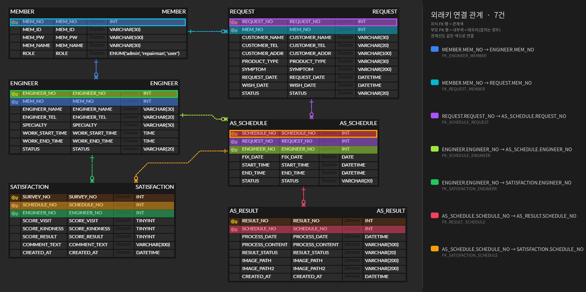

# AIR LINK — 냉·난방 AS기사 스케줄 관리 시스템

> 고객 신청부터 기사 배정, 방문 결과 보고, 만족도 조사까지 냉·난방 AS 전 과정을 하나의 웹에서 처리하는 업무 시스템

## 개요

| 구분 | 내용 |
| --- | --- |
| 팀 | Hello World (4인) |
| 기간 | 2026.09.07 ~ 09.15 (실작업 약 7일) |
| 내 역할 | 팀장 · 메인·로그인 · 공통 레이아웃 · 권한별 화면 분기 · 접근제어 인터셉터 · 고객 화면(A/S 신청·신청 내역) · Git 통합 |
| 작업일지 | [Notion 작업일지](https://app.notion.com/p/3d55abab4a9a80199fd8ff5ac19671a0) |

## 화면

## 주요 기능

데이터가 **고객 신청 → 관리자 배정 → 기사 방문·결과 등록 → 고객 만족도 응답**으로 한 바퀴 돕니다. 로그인하면 `MEMBER.ROLE`(`user` / `repairman` / `admin`)에 따라 첫 화면과 메뉴가 달라집니다.

| 사용자 | 기능 |
| --- | --- |
| 고객 | A/S 신청(신청번호 발급), 신청 내역·진행 상태·배정 기사 조회, 문자로 받은 링크에서 만족도 조사(방문·친절·처리 결과 각 5단계 + 후기) |
| 기사 | 오늘·이번 달 일정 확인, 방문 후 처리 내용과 사진 등록, 완료 시 고객에게 만족도 문자 자동 발송, 본인 만족도 현황 |
| 관리자 | 상태별 건수 카드와 최근 접수 현황, 기사 등록·수정·퇴사 처리, 캘린더 일정 배정(시간 겹침 표시), 처리 결과·사진 조회 |

## 기술 스택

| 구분 | 기술 |
| --- | --- |
| Backend | Java, Spring Boot 4.0.8, MyBatis, MariaDB, Gradle |
| Frontend | Thymeleaf, HTML, CSS, JavaScript, FullCalendar |
| 외부 서비스 | Solapi(문자 발송), Cloudflare Tunnel(설문 링크 외부 접속) |
| 협업 | GitHub, Notion, ERDCloud |

## DB 설계

화면을 먼저 설계한 뒤 필요한 테이블을 도출했습니다. 테이블 6개, 외래키 7건이며, 신청(`REQUEST`)이 배정(`AS_SCHEDULE`)으로, 다시 결과(`AS_RESULT`)·만족도(`SATISFACTION`)로 이어집니다.

## 협업 방식

계층(백엔드/프론트)이 아니라 **화면 단위**로 담당을 나눠, 각자 한 화면을 처음부터 끝까지 구현했습니다. 계층별로 나누면 서로 기다리는 시간이 길어진다고 판단했습니다. 각자 맡은 화면 폴더 안에서만 작업해 파일 충돌을 줄였고, 브랜치는 `main` / `dev` / `feature/*`로 운영했습니다. 의사결정·트러블슈팅·작업일지를 기록으로 남겼습니다.

## 문제 해결

**1. 로그인 없이 관리자 화면에 접근되던 문제** ([일지](https://app.notion.com/p/3dd5abab4a9a8143af24ea98a6c0643b))
- 화면별로 개발하다 보니 컨트롤러마다 세션 체크가 빠져 있어, URL만 알면 관리자 화면에 들어갈 수 있었습니다.
- `LoginCheckInterceptor` 하나로 모든 요청의 로그인 여부와 role을 검사하도록 바꿨습니다. 새 화면은 URL 접두사 한 줄만 추가하면 됩니다.

**2. 팀원마다 달랐던 SQL 통합** ([일지](https://app.notion.com/p/3dd5abab4a9a8105b03fe7d507110683))
- 같은 `AS_SCHEDULE` 테이블의 컬럼이 화면마다 달랐습니다. 파일을 하나씩 대조해 쓰이는 컬럼을 잃지 않도록 `테이블생성쿼리.sql` 하나로 합쳤습니다.

**3. 발표 직전 겹친 PR 4건** ([일지](https://app.notion.com/p/3dd5abab4a9a81228cd7c44c8c88e63b))
- 한꺼번에 합치지 않고 하나씩 병합하며 매번 화면이 깨지는지 확인해, 문제가 생겨도 원인을 바로 좁힐 수 있게 했습니다.

## 한계와 개선 방향

- **비밀번호가 DB에 평문으로 저장**됩니다. 로그인 로직과 함께 해시 저장으로 바꿔야 합니다.
- **일정 겹침 확인이 브라우저에서만** 이뤄져, 두 사람이 동시에 배정하면 겹칠 수 있습니다. 서버·DB에서 한 번 더 막아야 합니다.
- 일정 저장과 상태 변경이 따로 실행돼 중간에 어긋날 수 있습니다. 트랜잭션으로 묶는 것이 과제입니다.
- 고객에게 배정·완료 알림이 가지 않습니다. 문자·푸시 알림을 추가할 계획입니다.

## 실행 방법

1. MariaDB에 데이터베이스를 만들고 `테이블생성쿼리.sql`을 실행합니다.
2. 설정 파일(`application`)에 DB 접속 정보를 입력합니다. 문자 발송 기능을 쓰려면 Solapi 설정도 필요합니다.
3. `./gradlew bootRun`으로 실행한 뒤 브라우저로 접속합니다.

## 배운 점

짧은 기간에는 "누가 잘하는가"보다 "대기 시간이 얼마나 생기는가"로 역할을 나누는 편이 실용적이었습니다. 다만 화면 단위로 나누면 로그인 검사나 DB 정의처럼 화면을 가로지르는 부분에 구멍이 생기기 쉬워, 검사 지점을 인터셉터 한 곳으로 모아야 화면이 늘어도 안전하다는 것을 배웠습니다.
